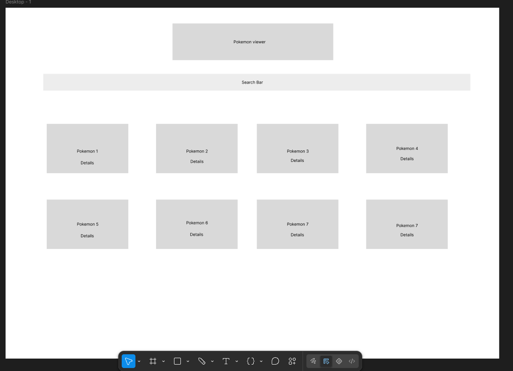
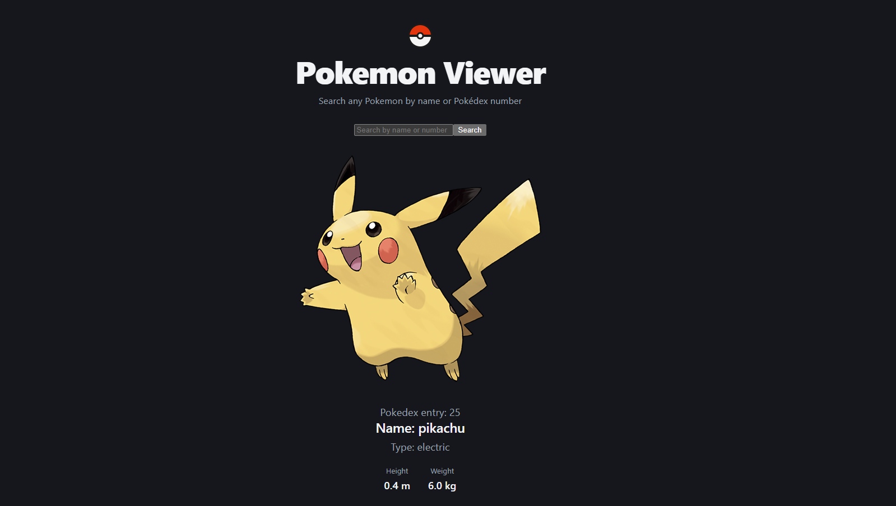

# Pokemon Viewer

A locally run web app for searching Pokemon. The React frontend talks to an Express backend. The backend gets data from [PokéAPI](https://pokeapi.co/) and trims it down to only what the UI needs.

Initial design made in figma 

Current state of frontend


## Features

- [x] Look up a Pokemon by name or id (API)
- [x] Search page in the frontend

## Tech stack

| Part | Tools |
|---|---|
| Frontend | React 19, TypeScript, Vite |
| Backend | Node.js, Express 5, TypeScript, tsx |
| Data | [PokéAPI](https://pokeapi.co/) (free, no API key needed) |

## Project structure

```
Frontend:
client/src/
  api/  components/  pages/  types/

Backend:
server/src/
  routes/  services/  types/
```


## Getting started

### Prerequisites

- [Node.js](https://nodejs.org/) 20 or newer
- npm

### Install

```bash
cd server -> npm install
cd ../client -> npm install
```

### Run in development

Start each part in its own terminal:

```bash
# Terminal 1: backend on http://localhost:3001
cd server
npm run dev
```

```bash
# Terminal 2: frontend on http://localhost:5173
cd client
npm run dev
```

Then open http://localhost:5173.

## Scripts

### Server (`server/`)

| Command | Description |
|---|---|
| `npm run dev` | Start the server and restart on file changes |
| `npm run build` | Compile TypeScript to `dist/` |

### Client (`client/`)

| Command | Description |
|---|---|
| `npm run dev` | Start the Vite dev server |
| `npm run build` | Type-check and build for production |
| `npm run preview` | Preview the production build |
| `npm run lint` | Run ESLint |

## API

Backend runs on port 3001

Base URL: `http://localhost:3001/api`

### `GET /pokemon/:name`

Returns one Pokemon. `:name` can be a name (`pikachu`) or a Pokedex number (`25`) and isn't case-sensitive.

**Example response**

```json
{
  "id": 25,
  "name": "pikachu",
  "sprite": "https://raw.githubusercontent.com/PokeAPI/sprites/master/sprites/pokemon/other/official-artwork/25.png",
  "types": ["electric"],
  "height": 4,
  "weight": 60
}
```


**Errors**

| Status | When |
|---|---|
| `404` | No Pokemon matches the name or id: `{ "error": "Pokemon not found" }` |
| `500` | PokeAPI request failed |


## Roadmap

Due to time constraint if I would continue the application I would work on the following:

1. Separate page for viewing all Pokemon (E.g top=20, skip=20).
2. Api call for fetching all Pokemon with above criteria.
3. Routing with `react-router-dom` (Search page and list page).
4. Testing suite.
5. Potential race condition issue with Pokemon search. (E.g 1st function call takes a long time and the user makes a 2nd call quickly after the first).
6. Application deployment (E.g Vercel)


## Acknowledgements

- Pokemon data and images come from [PokéAPI](https://pokeapi.co/).